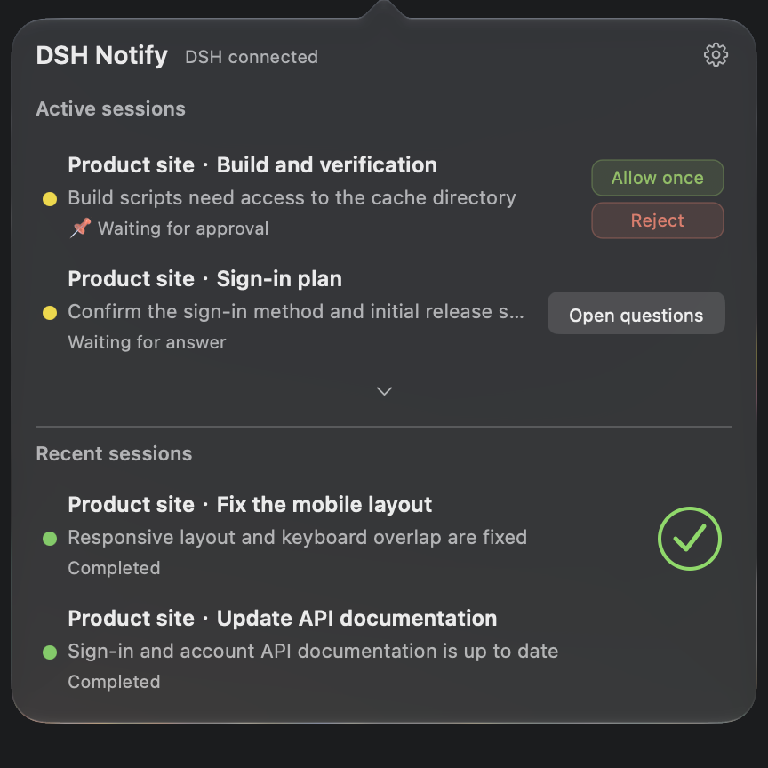
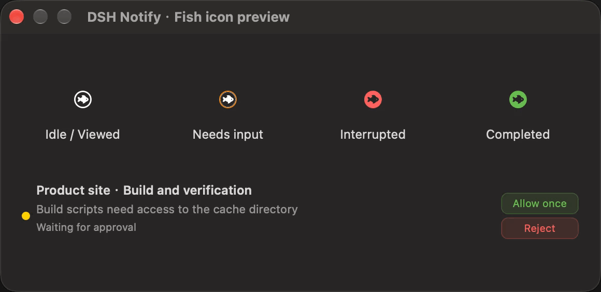
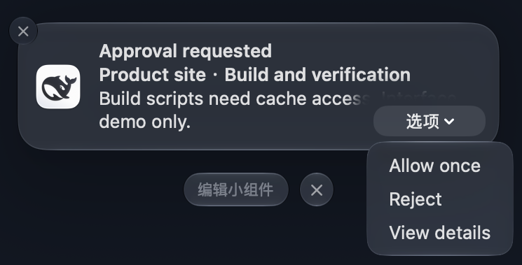
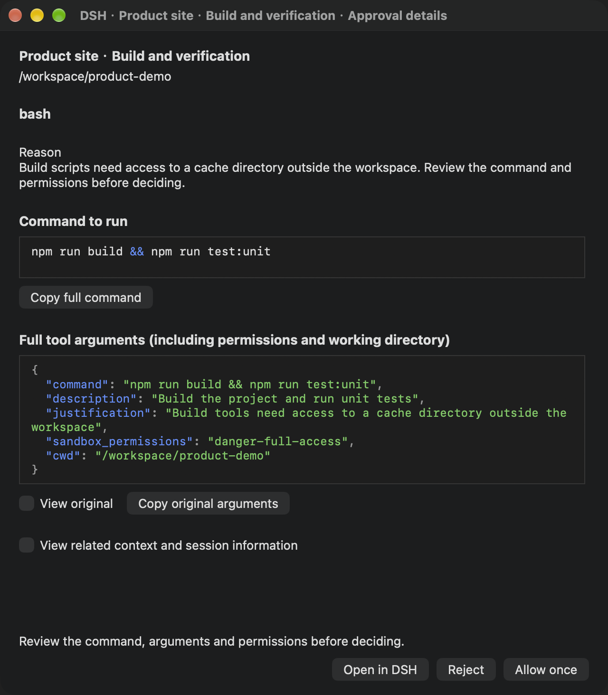
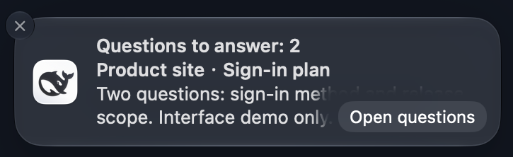
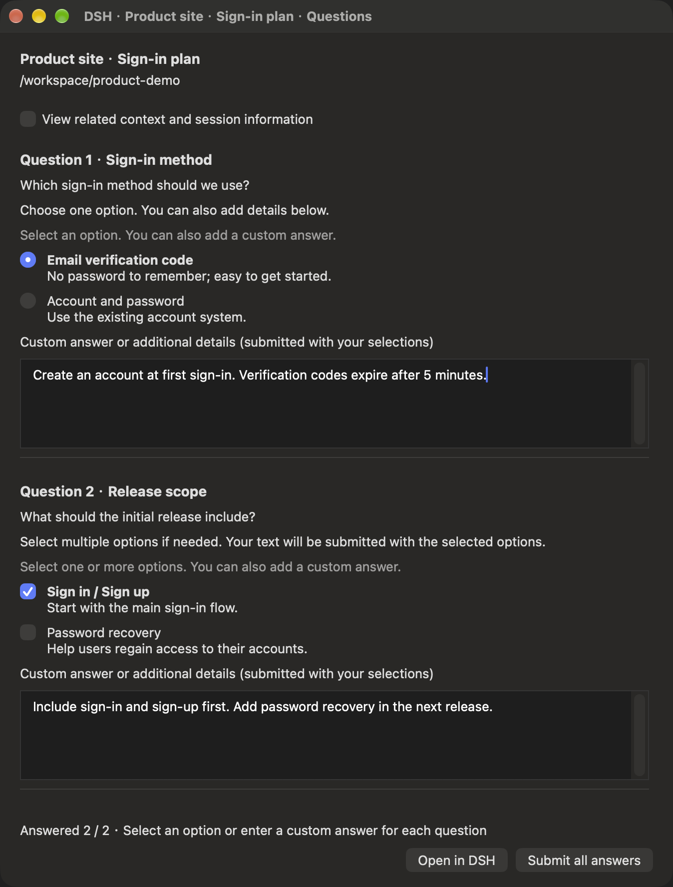

# DSH Notify

[简体中文](README.md) · [English](README.en.md) · [日本語](README.ja.md) · [Español](README.es.md) · **Français** · [Deutsch](README.de.md) · [Русский](README.ru.md) · [Português](README.pt.md)

Ajoutez à **DeepSeek Harness Desktop** des notifications macOS natives, des approbations, des formulaires de questions et un panneau de séances dans la barre des menus. Répondez à une demande depuis une notification ou retrouvez son espace de travail et sa séance dans Desktop.

Le projet associe un plugin DSH et l'application auxiliaire **DSH Notify.app**, qui démarre et s'arrête avec Desktop. Aucun navigateur, DSH Bridge ou service de modèle supplémentaire n'est nécessaire. Ce plugin est communautaire ; la version stable actuelle est **v0.5.0**. Voir les [versions et téléchargements](https://github.com/realDGD/dsh-macos-notify/releases/tag/v0.5.0).

## Fonctions

| Fonction | Utilisation |
| --- | --- |
| Notifications natives | Signale la fin d'une tâche, les erreurs, les approbations et les questions ; un clic ramène à la bonne séance. |
| Approbation rapide | Choisissez **Autoriser une fois** ou **Rejeter** dans la notification ou le menu, ou ouvrez les détails pour vérifier la commande. |
| Formulaires complets | Une alerte ouvre toutes les questions, avec choix unique ou multiple, champs de texte distincts et envoi groupé. |
| Panneau de séances | Affiche l'activité, les sous-agents imbriqués et les cinq séances principales récentes, avec état et progression. |
| Contexte et code | Affiche localement les tableaux Markdown, les formules et le code ; coloration Shell/JSON et retour à la ligne des commandes et arguments. |
| Langues | Suit DSH en chinois simplifié, anglais, japonais, espagnol, français, allemand, russe et portugais. Les noms, questions, choix, réponses et commandes restent dans leur langue d'origine. |

Les six langues ajoutées sont disponibles dans le code source actuel et n'ont pas encore été publiées dans une version stable. Recompilez l'application auxiliaire de la même révision pour les utiliser. Voir les [sources terminologiques et la maintenance](docs/localization.md).

DSH décide si une demande reste valide. La première réponse acceptée prévaut ; les demandes traitées, annulées ou expirées sont retirées et les anciens boutons ne répètent aucune action. Fermer une fenêtre de questions ou perdre brièvement la connexion conserve les brouillons. **Effacer les réponses** réinitialise les choix et le texte sans annuler la demande. Les brouillons restent en mémoire et sont effacés lorsque DSH confirme la réponse, l'annulation ou le retrait. Quitter l'application auxiliaire supprime les brouillons non envoyés. Un résultat non confirmé ne déclenche jamais de nouvel essai automatique.

## Aperçu de l'interface

**Les images et enregistrements ci-dessous utilisent l'interface anglaise comme exemple. Le plugin propose également une interface française.** Ce sont de vraies captures natives utilisant des espaces de travail, séances et demandes fictifs. Les commandes du Centre de notifications suivent la langue de macOS. Cliquez pour agrandir. Voir les [sources et limites des images](docs/images/README.md).

### Séances et actions rapides

<table>
<tr><th>Menu des séances</th><th>États et animation du poisson</th></tr>
<tr>
<td valign="top"><a href="docs/images/menu-sessions-en.png"></a></td>
<td valign="top"><a href="docs/images/menu-icon-states-en.gif"></a></td>
</tr>
</table>

Le poisson tourne pendant l'exécution. L'orange indique une approbation ou une question, le rouge une interruption anormale, le vert une fin de tâche. Priorité : **saisie attendue > arrêt anormal > fin de tâche**. Ouvrir le panneau rétablit l'icône blanche. Un arrêt volontaire ne produit pas d'alerte d'erreur.

### Approbations et détails

<table>
<tr><th>Notification et actions</th><th>Vérification des commandes et permissions</th></tr>
<tr>
<td valign="top"><a href="docs/images/notification-approval-en.png"></a></td>
<td valign="top"><a href="docs/images/approval-details-en.png"></a></td>
</tr>
</table>

**Voir les détails** ouvre le motif, la commande, les arguments complets et le contexte. Les arguments sont indentés et les lignes longues se replient. **Voir l'original** et **Copier les arguments d'origine** préservent la source. La mise en forme ne modifie pas la demande envoyée à DSH.

### Questions et formulaires

<table>
<tr><th>Notification de questions</th><th>Choix et texte pour chaque question</th></tr>
<tr>
<td valign="top"><a href="docs/images/notification-questionnaire-en.png"></a></td>
<td valign="top"><a href="docs/images/questionnaire-en.png"></a></td>
</tr>
</table>

**Ouvrir les questions** affiche le formulaire entier ; **Envoyer toutes les réponses** l'envoie en une fois. Si vous répondez dans DSH d'abord, l'ancienne notification devient invalide. **Ouvrir dans DSH** ferme la fenêtre après confirmation de l'ouverture de la bonne séance. Les démonstrations n'exécutent aucune commande, n'appellent aucun modèle et n'envoient aucune réponse réelle.

<a id="installation"></a>

## Installation

**L'installation depuis le gestionnaire de plugins de DSH Desktop est recommandée.** Il faut macOS 13 ou ultérieur, DSH Desktop officiel et Apple Command Line Tools. La compatibilité d'exécution et l'état de l'application auxiliaire ont été vérifiés sur `0.2.2-rc.1`. Desktop utilise son Node.js/pnpm intégré ; Node.js 22+ séparément n'est nécessaire que pour une compilation manuelle ou le développement. Voir la [compatibilité](docs/compatibility.md) pour les limites concernant les anciens macOS, Intel et les clics réels.

`v0.5.0` installe automatiquement l'application auxiliaire. L'ancien `v0.5.0-preview.1` exige les étapes manuelles. Pour les nouvelles langues, consultez aussi la note sur le code source ci-dessus.

1. Exécutez cette commande dans Terminal et terminez l'installation système des outils. S'ils sont déjà présents, continuez. Xcode complet et certificat payant sont inutiles.

   ```sh
   xcode-select --install
   ```

2. Dans Desktop, ouvrez **Plugins → Ajouter un plugin**, collez cette adresse, vérifiez que la source est fiable puis choisissez **Installer** :

   ```text
   github:realDGD/dsh-macos-notify
   ```

3. Si les scripts sont bloqués, examinez le plugin puis choisissez **Autoriser ces scripts et réessayer**. L'application est compilée dans `/Applications/DSH Notify.app`. Une compilation identique est réutilisée ; les mises à jour gardent les réglages et sauvegardent l'ancienne application.
4. Choisissez **Activer maintenant**. Enregistrez votre travail, quittez Desktop avec **⌘Q**, puis rouvrez-le ; fermer une fenêtre ne suffit pas. Autorisez les notifications de **DSH Notify** à la demande de macOS.
5. Dans **Réglages → DSH Notify**, vérifiez connexion et permissions. Envoyez la notification de test puis cliquez dessus pour vérifier la bonne séance. L'acceptation par macOS confirme seulement la prise en charge de la notification ; le clic vérifie la navigation.

Voir le [guide officiel des plugins](https://github.com/deepseek-ai/deepseek-harness/blob/master/packages/client/ui-plugin-manager/README.md).

### Depuis Terminal

Installez la commande via **Manage dsh Command…** dans le menu de Desktop, ouvrez un nouveau terminal et exécutez :

```sh
dsh plugin --profile desktop add github:realDGD/dsh-macos-notify
```

Desktop utilise le profil `desktop` ; `--profile web` cible un environnement Web distinct. Autorisez les scripts via le gestionnaire si nécessaire. Voir les [instructions détaillées](docs/install.md) et le [guide officiel de la commande](https://github.com/deepseek-ai/deepseek-harness/blob/master/apps/desktop/README.md#terminal-command).

### Demander à DSH de vous aider

Copiez ce message dans une nouvelle conversation :

```text
Installe DSH Notify dans DeepSeek Harness Desktop officiel sur ce Mac :
https://github.com/realDGD/dsh-macos-notify
Lis d'abord README et docs/install.md. Vérifie la version de DSH, macOS 13+ et Command Line Tools.
Utilise le profil desktop et le gestionnaire de plugins ou la commande dsh intégrée.
Vérifie que la version contient la langue nécessaire et compile /Applications/DSH Notify.app depuis la même révision que le plugin.
Conserve les réglages et sauvegardes. Explique mes actions nécessaires pour l'installation système, l'autorisation des scripts et les notifications.
Demande-moi d'enregistrer mon travail, de quitter puis rouvrir Desktop. Guide-moi jusqu'à l'envoi et au clic de la notification de test pour vérifier la bonne séance.
```

### Installation manuelle

Pour les anciennes préversions, les échecs d'installation automatique ou le développement, installez Command Line Tools et [Node.js 22+](https://nodejs.org/en/download), puis :

```sh
git clone https://github.com/realDGD/dsh-macos-notify.git
cd dsh-macos-notify
npm ci --ignore-scripts
bash macos/install.sh
pwd
```

Collez le chemin absolu de `pwd` dans **Plugins → Ajouter un plugin**, puis activez, redémarrez et testez. Vous pouvez aussi extraire une archive source complète de [Releases](https://github.com/realDGD/dsh-macos-notify/releases) et commencer à `npm ci --ignore-scripts`. Gardez le plugin et l'application auxiliaire à la même révision. L'icône provient normalement de `/Applications/DeepSeek Harness.app` ; une autre installation se configure selon le [guide](docs/install.md).

### Problèmes courants

| Problème | Solution |
| --- | --- |
| `swiftc` absent | Terminez l'installation lancée par `xcode-select --install`, puis réessayez. |
| Scripts bloqués | Autorisez les scripts et réessayez dans DSH. |
| Commande `dsh` introuvable | Utilisez le gestionnaire ou réparez la commande depuis Desktop, puis ouvrez un nouveau terminal. |
| Version incompatible | Choisissez des versions correspondantes dans le [guide](docs/compatibility.md). |
| Application auxiliaire absente ou mise à jour refusée | Utilisez la procédure manuelle, ou traitez les brouillons et fermez les fenêtres de questions et d'approbation. |
| GitHub inaccessible | Vérifiez la connexion ou utilisez une archive complète déjà téléchargée. Changer de registre npm ne télécharge pas GitHub. |
| Aucune notification | Vérifiez **Réglages Système → Notifications → DSH Notify** et les modes de concentration, puis envoyez un test. |

L'application auxiliaire suit Desktop ; elle n'est pas un élément d'ouverture de session.

## Utilisation quotidienne

- Cliquez sur le poisson. L'activité donne priorité aux séances épinglées, aux saisies attendues et aux arrêts anormaux, puis aux tâches en cours. Les séances récentes sont limitées à cinq séances principales, sans doublons ni sous-agents.
- Les quotas des sections comptent seulement les séances principales. Développer une séance montre deux sous-agents ; la ligne supplémentaire révèle les autres. La hauteur augmente puis les flèches haut/bas permettent de parcourir le reste. Ni molette ni barre de défilement. Une vue d'une seule ligne ne fixe pas la séance parente.
- Haut/Bas sélectionnent la ligne des sous-agents supplémentaires. Entrée/Espace développent ou réduisent ; Droite développe aussi. Le focus rejoint le premier sous-agent révélé. Gauche sur cette ligne revient au parent.
- Le nombre de tâches figure dans l'anneau de progression ; un plan terminé devient une coche verte. Sans plan, pas d'anneau. Les boutons d'approbation sont verticaux ; les questions ouvrent le formulaire. **Actions** distingue plusieurs demandes d'une même séance.
- Les réglages contrôlent les types, le son, les résultats séparés des sous-agents, l'attente de leur fin et le silence pendant la consultation d'une séance.
- Le clic droit ouvre DSH, les réglages de DSH Notify, le masquage de la barre ou la sortie de DSH. L'engrenage ouvre aussi les réglages. Cliquer à l'extérieur ferme le panneau tout en gardant les fenêtres indépendantes.
- Quitter exige confirmation si des tâches s'exécutent, attendent une approbation ou une réponse, ou si leur état est ancien, incomplet ou indisponible. Une fermeture normale de DSH est demandée.
- Masquer la barre laisse disponibles notifications et fenêtres natives. Réactivez-la dans les réglages de DSH Notify.
- Modifiez la langue dans DSH. Les fenêtres ouvertes actualisent leurs textes en conservant choix et brouillons ; les notifications déjà distribuées gardent leur langue d'envoi.

Le contexte est rendu localement avec Markdown et KaTeX : titres, listes, citations, tableaux, formules et code. Les images distantes ne sont pas chargées automatiquement et le HTML reste inerte. Les textes longs signalent leur limite ; ouvrez DSH pour tout lire.

## Mise à jour et désinstallation

Enregistrez le travail, traitez les brouillons et fermez les fenêtres natives avant la mise à jour. Dans le gestionnaire actuel, **supprimez le plugin puis ajoutez-le à nouveau**. Les versions avec installation automatique vérifient aussi l'application auxiliaire. Pour une installation manuelle, exécutez `npm ci --ignore-scripts` et `bash macos/install.sh`, puis ajoutez le même répertoire. Redémarrez Desktop normalement. Réglages et sauvegardes sont conservés ; l'ancien processus doit être arrêté avant remplacement.

Depuis `dsh-notify-web` / `DSH Jump.app`, retirez l'ancien plugin de notification et le relais de fin/erreur pour éviter les doublons. L'identité historique de l'application est conservée pour les permissions et la compatibilité.

Pour désinstaller, retirez le plugin dans DSH puis exécutez depuis le répertoire source :

```sh
bash macos/uninstall.sh
```

Redémarrez Desktop. Réglages et sauvegardes restent ; seuls les fichiers gérés par cet installateur sont supprimés.

## Confidentialité et limites

Aucun écouteur réseau, service cloud ou séance de modèle supplémentaire n'est créé. Navigation et réglages utilisent la connexion authentifiée de DSH et des fichiers privés de l'utilisateur. Questions et approbations sont conservées temporairement pour afficher les formulaires et ne sont pas exportées dans les diagnostics. N'envoyez pas d'état local, jetons, conversations ou captures de données réelles non masquées dans les signalements.

macOS contrôle notifications, concentration et aperçus verrouillés. Le silence n'approuve, ne rejette et ne répond jamais automatiquement. Un seul Host/répertoire d'état local actif est pris en charge. Plusieurs Hosts partageant ce répertoire, les anciens macOS et Intel ne sont pas vérifiés sur matériel réel. Les validations locales existantes couvrent développement du menu, navigation récente, conservation des brouillons, effacement et retrait après réponse ou annulation dans DSH ; elles ne prouvent pas une validation réelle dans chaque langue.

## Développement et vérification

```sh
npm ci --ignore-scripts
npm test
npm run test:native
npm run check:release
```

L'archive complète inclut tests, fichiers de verrouillage, CI et scripts de compilation. Le `.tgz` inclut le code d'exécution et les sources de l'application auxiliaire, sans tous les tests. Voir la [procédure de publication](docs/release.md) et le [journal des modifications](CHANGELOG.md).

## Licence

[MIT](LICENSE). Le nom DSH et l'icône officielle obtenue localement identifient l'intégration sans accorder de droits sur les marques tierces. Les ressources de rendu et leurs licences figurent dans [THIRD_PARTY](THIRD_PARTY.md).
